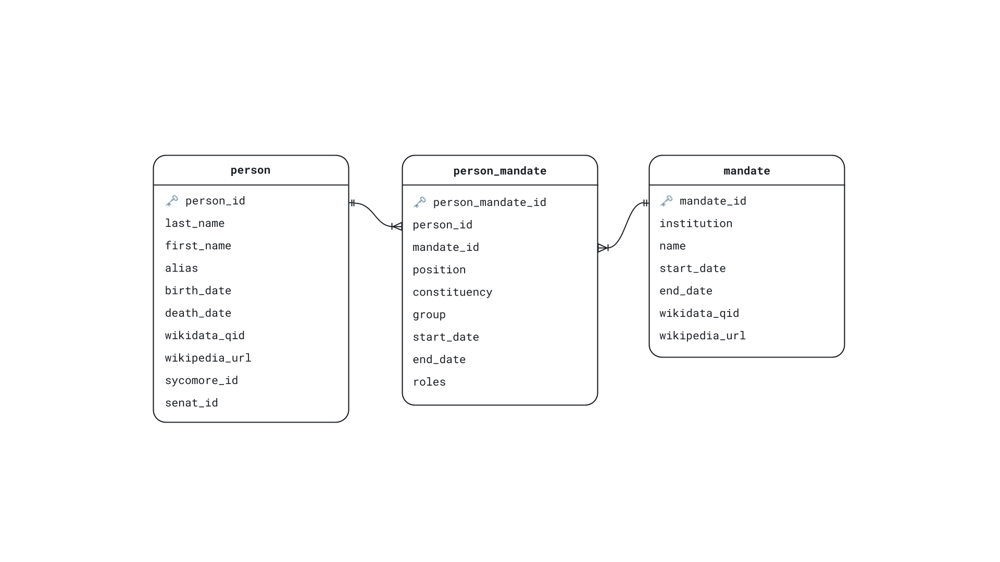

# decidon-prosopography

This repository contains the data scraping pipeline and search
application for a prosopographic SQLite database of ministers, deputies,
and senators of the French Third Republic (1870–1940).

The database was designed for DECIDON, a project that studies how
Parliament and the press influence each other's allocation of attention
to policy issues, a process known as agenda-setting.
To understand how information circulates between Parliament and the press, the project requires structured data on office holders: who they are and, in particular, what position they hold when they speak or are spoken about. The prosopographic database was created to meet this need.

The repository is organized into two components:

- [`decidon_scraping/`](decidon_scraping/): scripts for collecting,
  reconciling, and validating prosopographic information from three
  sources: the Wikipedia list of French governments for ministers,
  Sycomore, the Assemblée nationale’s database, for deputies, and
  official lists published by the Sénat for senators.
- [`decidon_app/`](decidon_app/): tools for building the relational
  SQLite database from the processed data and querying it through a
  FastAPI search application.


## Repository Structure

```text
.
├── decidon_scraping/
│   ├── scripts/        # Scraping, merging, and validation
│   └── output/         # CSVs, merged TSV, and validation reports
├── decidon_app/
│   ├── api/            # Search API and indexing scripts
│   ├── db_build/       # Database-building script
│   └── front-end/      # Frontend development
├── docs/               # Figures
├── requirements.txt
└── README.md
```

## Data Sources

Data were collected in March 2026 from three sources:

| Office holders | Source |
|---|---|
| Deputies | [Sycomore, Assemblée nationale](https://www2.assemblee-nationale.fr/sycomore/liste/) |
| Senators | [Sénat: senators of the Third Republic](https://www.senat.fr/senateurs-3eme-republique/senatl.html) |
| Ministers | [French Wikipedia: list of French governments](https://fr.wikipedia.org/wiki/Liste_des_gouvernements_de_la_France) |

Ministers are included whether or not they also sat in either chamber.

The version described in the accompanying data paper contains 5,792
people, 149 offices or legislative terms, and 16,941 person–office
associations.

## Database Structure



| Table | Contents |
|---|---|
| `person` | Names, aliases, birth and death dates, and source identifiers |
| `mandate` | Institutions, offices or legislative terms, dates, and associated identifiers |
| `person_mandate` | Person–office associations, individual tenure dates, constituency, political affiliation, and additional roles |

The model separates identity from appointments: a person is recorded once
and can be linked to multiple offices across institutions. Attributes
that change between appointments belong to `person_mandate`.

This supports career reconstruction, date-based searches for office
holders, and the contextualization of person mentions. Individual tenure
dates may differ from the dates of an office or legislature.

## Getting Started

- To collect and process the data, see
  [decidon_scraping/README.md](decidon_scraping/README.md).
- To build the SQLite database and work with the API, see
  [decidon_app/README.md](decidon_app/README.md).
