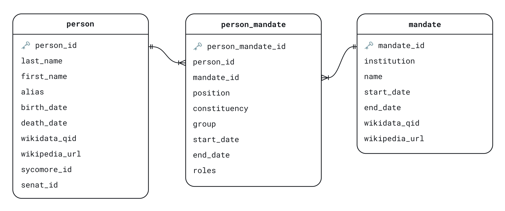
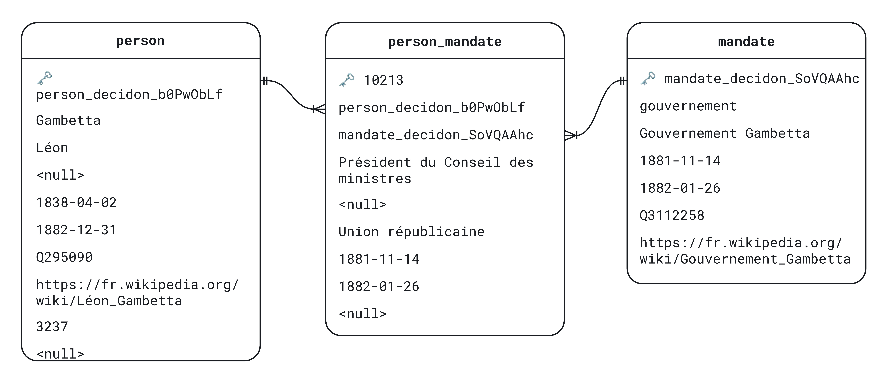
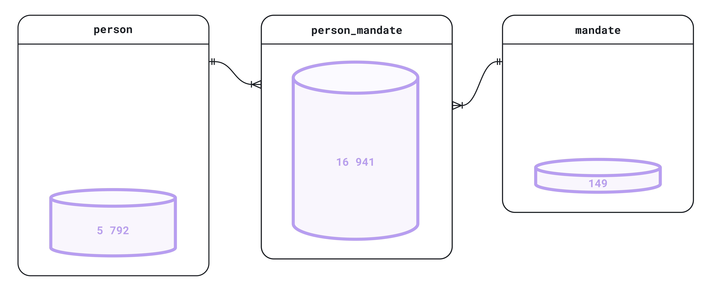

# decidon-prosopography

This repository contains the code used to build a prosopographic database of ministers, deputies, and senators of the French Third Republic (1870–1940). 
It also includes a FastAPI search application and a Whoosh search engine for retrieving prosopographic records from the database.

The database was designed for DECIDON, a research project that studies how Parliament and the press influence each other's allocation of attention to policy issues, a process known as agenda-setting.
To understand how information circulates between Parliament and the press, the researchers need structured data on office holders: who they are and, in particular, what position they hold when they speak or are spoken about. The data are structured in a relational schema, so that named entities extracted from the verbatim accounts of parliamentary sessions and from press articles can be linked to person records and to the offices these persons held.

<p align="center">
  
  <br>
  <em>
    Figure 1. Journal officiel with verbatim records of what was said in Parliament.
    Source: <a href="https://gallica.bnf.fr/ark:/12148/bpt6k64574218/f1.item">Gallica</a>.
  </em>
</p>

## Repository Structure

```text
├── decidon_scraping/
│   ├── scripts/        # Data scraping, reconciliation, and validation
│   └── output/         # Data outputs and validation reports
├── decidon_app/
│   ├── api/            # FastAPI search application and a Whoosh search engine
│   ├── db_build/       # Relational SQLite database creation
│   └── front-end/      # Frontend development
├── docs/               # Figures
├── requirements.txt    # Python dependencies
└── README.md
```

## Data Sources

The dataset aggregates prosopographic information scraped from three sources: ministers from the [Wikipedia list](https://fr.wikipedia.org/wiki/Liste_des_gouvernements_de_la_France) of French governments, deputies from [Sycomore](https://www2.assemblee-nationale.fr/sycomore/liste/26), the Assemblée nationale’s database, and senators from [official lists](https://www.senat.fr/senateurs-3eme-republique/senatl.html) published by the Sénat.

## Database Structure

The schema has three tables: person, mandate and person_mandate (Figure 1). The person table stores biographical information: first and last name, alias, dates of birth and death, and source identifiers. The mandate table records offices: the institution (Gouvernement, Chambre or Sénat), the office name, its start and end dates, and Wikipedia and Wikidata identifiers. The junction table person_mandate links individuals to offices. It records the person's position, constituency, political party, individual tenure dates, and any additional roles (such as president or stenographer). The tenure dates are those of the individual, which may differ from the dates of the office or legislature recorded in mandate. In total, person contains 5,792 records, person_mandate 16,941 and mandate 149 (Figures 3).

<p align="center">
  
  <br>
  <em>
    Figure 2. Prosopographic database of elected officials: schema.
  </em>
</p>



<p align="center">
  <em>
    Figure 3. Prosopographic database of elected officials: example.
  </em>
</p>



<p align="center">
  <em>
    Figure 4. Prosopographic database of elected officials: record count.
  </em>
</p>

## Use Case

The database serves as a reference layer for named entity linking (NEL). After named entity recognition (NER) has identified person mentions in the digitized Journal officiel (the verbatim accounts of parliamentary sessions) and in the press corpora, the NEL stage matches each mention to a record in the database. Each candidate entity carries temporal attributes (mandate start and end dates) and institutional attributes (chamber, office, constituency, party). These attributes help resolve ambiguities that names alone cannot. Examples include homonyms and speakers referred to only by title, last name or alias. Candidates for a mention can be restricted to persons who held a mandate on the date of the session or article. Once linked, mentions can be filtered and aggregated by person, mandate, institution or party. This lets researchers trace who speaks and who is spoken about, and in what capacity, in both Parliament and the press.
