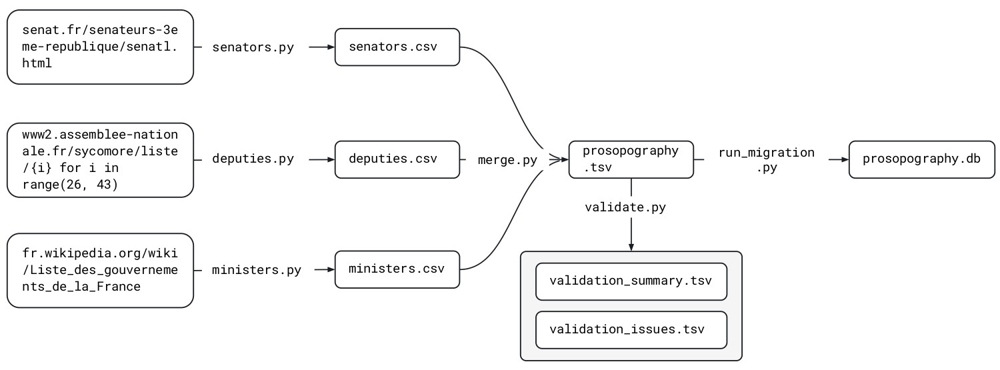
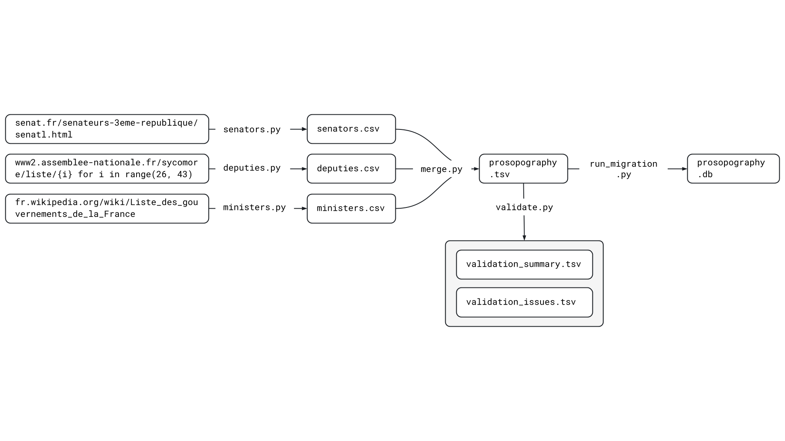

# XXX

  
   
  <em>
    Figure 1. Workflow from scraping to database creation.
  </em>

Scripts for collecting, merging, and validating records of deputies,
senators, and ministers of the French Third Republic (1870–1940).

See the [main README](../README.md) for the project context and database
description.

## Inputs

The collection described in the data paper was carried out in
March 2026.

| Source | Script | Output |
|---|---|---|
| [Sycomore, Assemblée nationale](https://www2.assemblee-nationale.fr/sycomore/liste/) | `scripts/deputies.py` | `output/deputies.csv` |
| [Sénat](https://www.senat.fr/senateurs-3eme-republique/senatl.html) | `scripts/senators.py` | `output/senators.csv` |
| [French Wikipedia](https://fr.wikipedia.org/wiki/Liste_des_gouvernements_de_la_France) | `scripts/ministers.py` | `output/ministers.csv` |

The source-specific CSV files are retained before cross-source merging.
Their row definitions and column-level documentation are being verified.

## Workflow

1. Collect source-specific records with `deputies.py`, `senators.py`,
   and `ministers.py`.
2. Merge and reconcile the CSV files with `merge.py`.
3. Validate the merged TSV with `validate.py`.
4. Build the SQLite database with
   `../decidon_app/db_build/run_migration.py`.

Validation and database building are separate operations on the merged
TSV. Review the validation reports before replacing the reference
dataset.

## Outputs

All intermediate files and reports are stored in `output/`.

| File | Contents |
|---|---|
| `deputies.csv` | Source-specific deputy records |
| `senators.csv` | Source-specific senator records |
| `ministers.csv` | Source-specific minister records |
| `prosopography.tsv` | Merged dataset used to build the database |
| `validation_summary.tsv` | Summary of validation results |
| `validation_issues.tsv` | Detailed validation issues |

## Reconciliation and validation

The same individual may appear in several sources. The methodology
described in the data paper uses Wikidata identifiers, where available,
and combinations of names and birth and death dates to reconcile
records.

The precise matching rules, conflict handling, and implemented validation
checks are being checked against the current scripts.

Validation reports do not establish that the dataset is error-free.
Missing information may originate in the source rather than in the
extraction process.

## Usage status

Dependencies, command-line options, path handling, and overwrite behavior
are being verified. Tested execution commands will be added here.

Before rerunning scripts, preserve the existing outputs and database.

Different starting points support different operations:

| Starting point | Operation |
|---|---|
| `prosopography.tsv` | Rebuild the SQLite database |
| Source-specific CSV files | Repeat merging, validation, and database building |
| Source websites | Repeat collection and the downstream pipeline |

Recollection requires network access. Changes to website content or
structure may affect both the extracted data and the scripts.

## Related documentation

- [Project overview](../README.md)
- [Database building and search API](../decidon_app/README.md)
